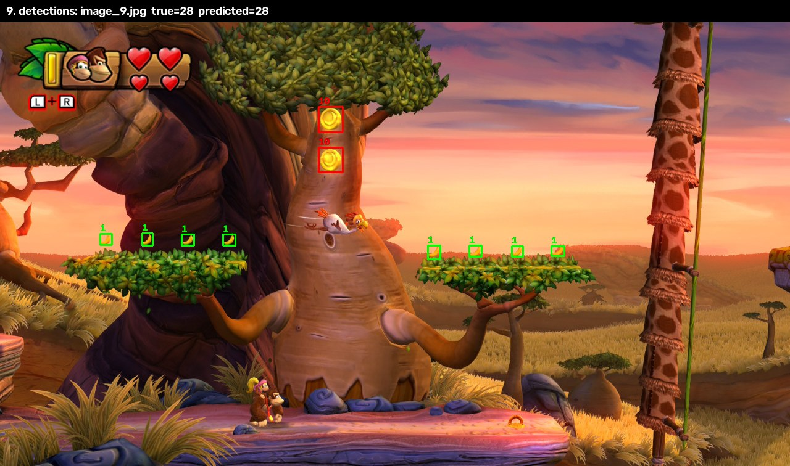
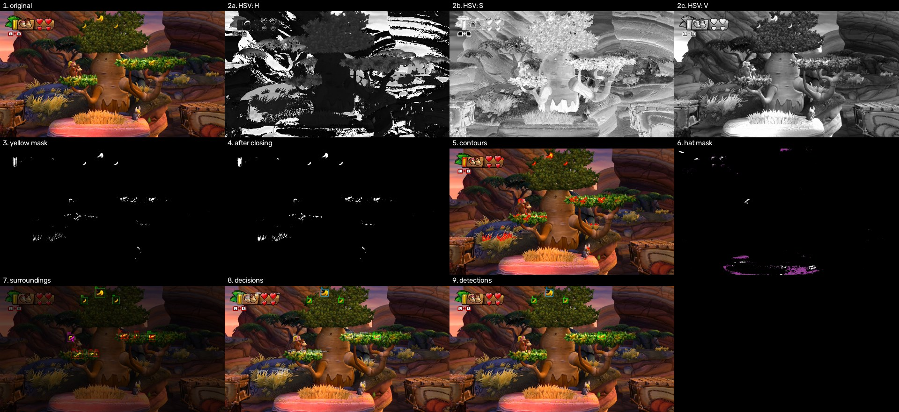
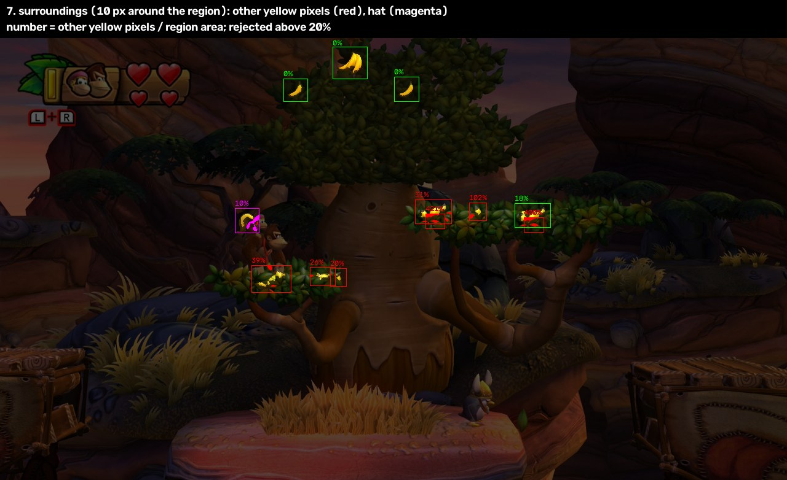

# Banana Counter

Counts the total value of collectibles in screenshots of Donkey Kong Country: Tropical Freeze, using classical image processing with OpenCV. No machine learning is involved.

| Object | Value |
|---|---|
| Banana | 1 |
| Banana bunch | 5 |
| Banana coin | 10 |

https://github.com/user-attachments/assets/cc34883c-3193-43ab-b135-895058bd14af

For each screenshot the script sums the values of all visible objects, then reports the mean absolute error (MAE) against the expected totals.



## How it works

Every image goes through the same steps:

1. **Resize** to 1280x720, because the size thresholds are in pixels.
2. **Convert to HSV.** Hue is separate from saturation and brightness, so "saturated, bright yellow" becomes a simple range.
3. **Yellow mask** with `cv2.inRange`: H from 20 to 34, S at least 170, V at least 185.
4. **Morphological closing** with a 5x5 ellipse. A bunch is drawn with dark lines between its bananas, and closing joins the pieces into one region.
5. **Contours** of the closed mask. Each contour is one candidate.
6. **Filters** reject candidates that are not collectibles.
7. **Classification by shape** into coin, bunch or banana.
8. **Sum** of the values is the prediction for the image.



### Filters

A candidate is rejected as soon as it fails one filter.

| Filter | A region is rejected when |
|---|---|
| HUD | its center lies in the HUD area at the left edge of the screen |
| Size | its area is below 10 pixels or its long side is above 60 px |
| Shape | it covers less than 30% of its rotated bounding box (thin or branched shapes) |
| Color | its yellow pixels have a mean saturation below 200 or a mean brightness below 210 |
| Isolation | other yellow pixels within 10 px of its bounding box exceed 20% of its area |
| Tail | a pink, hat-sized region lies within 10 px of its bounding box |

The mask checks every pixel with loose limits so that an object stays in one piece. The color filter then checks the average of the whole region with strict limits.

The isolation filter matters most. Collectibles hang alone, while leaves, grass and golden ornaments come in clusters of yellow blobs. Without this filter the MAE on the sample screenshots rises from 0.09 to 2.18.

The tail filter handles Dixie Kong's blonde ponytail, which has the color and shape of a banana but is always next to her pink hat.



### Shape classes

Sides are measured on the rotated bounding box (`cv2.minAreaRect`), so the angle of an object does not matter.

| Class | Condition |
|---|---|
| Coin (10) | covers at least 72% of its box, long side at least 24 px, side ratio at least 0.30 |
| Bunch (5) | side ratio at least 0.56 and short side at least 13 px |
| Banana (1) | side ratio below 0.56 |

The side ratio is the short side divided by the long side. It separates bananas from bunches at any camera distance, which the area alone cannot do.

Coins spin in the game, so a coin often appears as an ellipse. An ellipse covers about 79% of its bounding box no matter how flat it is, which is why the coin test uses coverage instead of roundness.

## Usage

Tested with Python 3.14, NumPy 2.5 and OpenCV 5.0.

```
pip install -r requirements.txt
python banana_counter.py data/
```

The script prints a single number, the MAE:

```
0.09090909090909091
```

The dataset folder must contain the screenshots and a CSV file with the expected total for each of them:

```
data/
    count.csv
    images/
        image_1.jpg
        ...
```

```
image_name,bananas_value
image_1.jpg,19
image_2.jpg,25
```

To write the step-by-step images for every screenshot into `examples/`:

```
python visualize.py
```

## Results

| Image | True value | Predicted |
|---|---|---|
| image_1.jpg | 19 | 19 |
| image_2.jpg | 25 | 25 |
| image_3.jpg | 13 | 13 |
| image_4.jpg | 40 | 40 |
| image_5.jpg | 10 | 10 |
| image_6.jpg | 35 | 35 |
| image_7.jpg | 100 | 100 |
| image_8.jpg | 100 | 100 |
| image_9.jpg | 28 | 28 |
| image_10.jpg | 20 | 20 |
| image_11.jpg | 7 | 8 |

MAE: 0.09. The only error is a yellow leaf in `image_11.jpg` that is counted as a banana.

## Example images

The `examples/` folder holds one subfolder per screenshot, with one image per step:

| File | Content |
|---|---|
| `0_overview.jpg` | all steps on one sheet |
| `1_original.jpg` | input image and its true value |
| `2a_hsv_h.jpg`, `2b_hsv_s.jpg`, `2c_hsv_v.jpg` | the three HSV channels |
| `3_yellow_mask.png` | yellow mask |
| `4_closed_mask.png` | mask after closing |
| `5_contours.jpg` | all contours |
| `6_hat_mask.png` | pink mask (purple) and hat-sized regions (white) |
| `7_surroundings.jpg` | isolation filter and tail filter |
| `8_decisions.jpg` | every contour with its decision |
| `9_detections.jpg` | accepted objects, true value and prediction |

In `7_surroundings.jpg` other yellow pixels are red, the hat is magenta, and the number above each box is the share of other yellow pixels. A green box passed, a red box was rejected by the isolation filter, a magenta box was rejected as a tail.

In `8_decisions.jpg` accepted objects have a thick box with their value: bananas green, bunches blue, coins red. Rejected regions have a thin white box with the reason:

| Label | Reason |
|---|---|
| `HUD` | center inside the HUD area |
| `large` | long side above 60 px |
| `shape` | covers less than 30% of its box |
| `color` | mean saturation below 200 or mean brightness below 210 |
| `crowded` | too many other yellow pixels around it |
| `tail` | next to a pink hat |
| `small` | compact region with a short side below 13 px |

Regions with an area below 10 pixels are not drawn. Their count is in the image header.

## Limitations

- The thresholds were tuned on the 11 sample screenshots, which show a savanna level and two bonus rooms.
- The color filter is sensitive to exposure. Scaling brightness or saturation by up to 10% keeps the MAE at 1.27 or below, but at 12% it reaches 8.45 in the worst case.
- Objects in deep shadow fall outside the yellow mask and are missed.
- When two objects are closer than 10 px, the isolation filter can reject the smaller one.
- The HUD and tail filters are specific to this game.

## Screenshots

The screenshots are from Donkey Kong Country: Tropical Freeze. The game and its artwork belong to Nintendo. The images are included for demonstration only.
